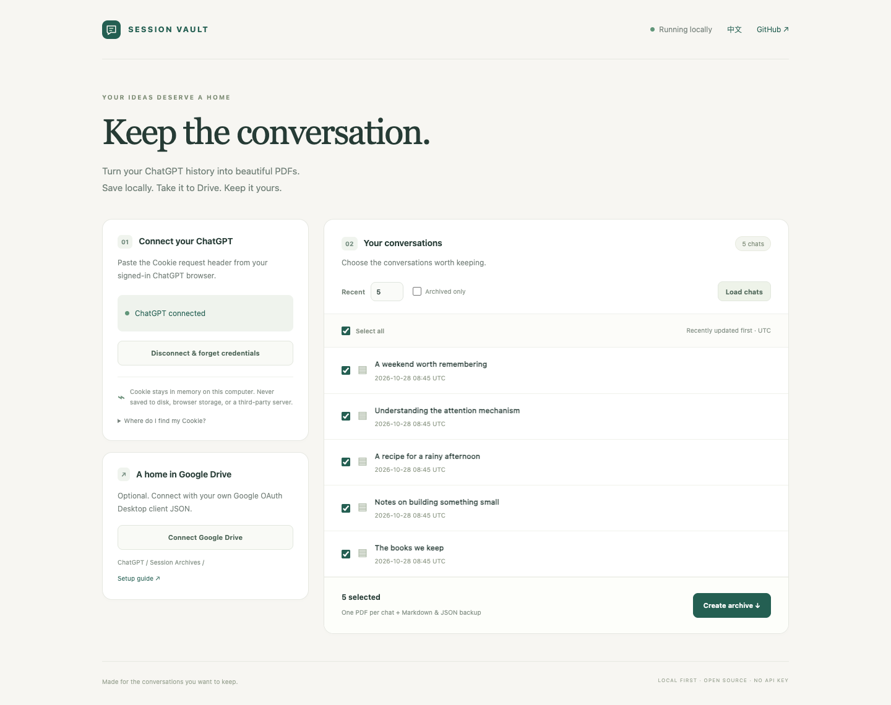

<div align="center">

# ChatGPT Session Vault

**Keep the conversation.**

Export your ChatGPT conversations to **PDF, Markdown and JSON**.<br>
Paste your browser Cookie. Pick your chats. Save locally or back up to Google Drive.

[](https://github.com/GitZhangChi/chatgpt-session-vault/actions/workflows/ci.yml)
[](https://www.python.org/)
[](LICENSE)

**Local web UI · CLI · Batch export · No OpenAI API key · English / 中文**

[Quick start](#quick-start) · [CLI](#cli) · [Google Drive](#google-drive-setup) · [Privacy](#privacy-and-security) · [中文说明](#中文说明)

</div>



ChatGPT Session Vault is an open-source **ChatGPT conversation exporter and backup tool** that runs on your own computer. Export the **last N recently updated chats** or select exact conversations, generate a separate searchable PDF for each chat, and optionally upload those PDFs to your own Google Drive.

No need to print each chat manually. No need to upload your Cookie to a hosted export service.

## Features

- **Cookie to archive:** paste a ChatGPT Cookie request header or supply a cookie JSON export.
- **Batch export:** get the latest N chats, select specific chats, or export by conversation UUID.
- **Readable PDFs:** headings, highlighted code, tables, Unicode text, and locally rendered LaTeX math.
- **Portable backups:** PDF + Markdown + original conversation JSON for every chat, plus one ZIP.
- **Branch-aware:** render the currently selected conversation branch instead of mixing regenerated answers.
- **Export manifest:** message counts, explicit missing-content warnings, per-chat failures and SHA-256 hashes.
- **Google Drive backup:** optional OAuth upload to `ChatGPT/Session Archives/` using your own Google client.
- **Two interfaces:** a bilingual local browser UI and a scriptable command-line interface.
- **Local first:** no analytics, no developer backend, no runtime CDN, and no stored session credentials.

## Quick start

Requirements: **Python 3.11+**, [uv](https://docs.astral.sh/uv/), and Chromium or Google Chrome. macOS, Linux and Windows are supported by the underlying dependencies; see [verification](#verification-and-limitations) for what this project actually tests.

```bash
git clone https://github.com/GitZhangChi/chatgpt-session-vault.git
cd chatgpt-session-vault
uv sync --locked
uv run playwright install chromium
uv run session-vault serve
```

On Linux, install Chromium's system dependencies with `uv run playwright install --with-deps chromium` instead. An installed Google Chrome is used as a fallback when Playwright Chromium is unavailable.

For Chinese/Japanese/Korean PDF text on Linux, install a CJK font, for example `sudo apt-get install fonts-noto-cjk` on Debian/Ubuntu. macOS and Windows normally provide system CJK fonts.

Open **http://127.0.0.1:8765**. Paste your Cookie, connect ChatGPT, load your latest chats and click **Create archive**. Download individual PDFs or the complete ZIP. Google Drive is optional.

The server binds to `127.0.0.1` only. It is a personal desktop tool; do not expose it through a public tunnel or reverse proxy.

### Get your ChatGPT Cookie

1. Sign in at **https://chatgpt.com** in your browser.
2. Open **Developer Tools → Network**, then reload the page.
3. Select a request to `chatgpt.com`, such as a `conversations` request.
4. Open **Headers → Request Headers → Cookie** and copy the complete value.
5. Paste it into Session Vault. The `Cookie:` prefix is accepted too.

Cookie JSON arrays from browser cookie exporters and `{ "cookie-name": "value" }` objects are also accepted. Chunked session cookies are preserved. Use a fresh Cookie from the same computer/network where Vault runs. If you receive 403, supply your browser's matching **User-Agent** in Advanced options.

**Your session Cookie grants access to your account. Never paste it into GitHub issues, screenshots, public websites, or chat messages.** Paste it only into the locally running tool.

## CLI

The default CLI flow prompts for your Cookie **without echoing it**. Secret values are deliberately not accepted as command-line arguments.

```bash
# List the five most recently updated conversations
uv run session-vault list

# Export the five latest chats; prompts for Cookie interactively
uv run session-vault export --limit 5 --output ~/ChatGPT-Archives

# Export exact conversations (repeat --id for multiple chats)
uv run session-vault export --id 00000000-0000-4000-8000-000000000001

# Read a Cookie header or cookie JSON from a local file
uv run session-vault export --cookie-file /path/outside/repo/cookie.txt --limit 20

# Machine-readable conversation list
uv run session-vault list --cookie-file /path/outside/repo/cookie.txt --json

# Read cookies from stdin, for example from a password manager
your-secret-reader | uv run session-vault export --cookie-stdin --limit 5

# macOS: read the clipboard without putting the Cookie in shell history
pbpaste | uv run session-vault export --cookie-stdin --limit 5

# Export archived conversations instead of active chats
uv run session-vault export --archived --limit 10

# Export and upload PDFs to your own Google Drive
uv run session-vault export --limit 5 --google-client /path/outside/repo/google-client.json

# Local web UI without automatically opening a browser
uv run session-vault serve --no-open --port 8765

uv run session-vault --help
uv run session-vault export --help
```

`--limit` accepts 1–500 and defaults to 5. Ordering uses ChatGPT's `order=updated` endpoint, then sorts returned items by update time. `--archived` selects the archived list separately. Supplying `--id` skips list discovery. Optional `--account-id` passes a workspace's `ChatGPT-Account-ID` header; Vault does not discover or switch workspaces automatically.

Exit codes: **0** success, **1** failure, **2** partial export (successful files are kept), **130** interrupted. Drive errors leave local exports intact. Uploading the same archive again from a separate run creates new Drive files.

### Output

Each run gets its own directory. The date in each filename is the conversation's last update date in **UTC**; a short conversation ID prevents collisions between chats with the same title.

```text
exports/<run-id>/
├── 2026-10-28_Example conversation_00000000.pdf
├── 2026-10-28_Example conversation_00000000.md
├── 2026-10-28_Example conversation_00000000.json
├── manifest.json
└── session-archives.zip
```

The web UI stores archives in the OS user-data directory by default, outside the source checkout. `serve --output /your/archive/path` overrides it. The CLI defaults to `./exports` (gitignored); use `--output` to choose another directory. Exports remain on disk until you delete them. Credentials are forgotten when the process exits; the UI also has **Disconnect & forget credentials**. Already running work finishes with the credential references it captured at start.

## Google Drive setup

ChatGPT cookies and Google authorization are separate. Connecting Google Drive in ChatGPT does **not** authorize this local tool.

1. Create/select a project in [Google Cloud Console](https://console.cloud.google.com/).
2. Enable the **Google Drive API**.
3. Configure the OAuth consent screen. For a testing app, add your Google account as a test user.
4. Create an OAuth client with application type **Desktop app** and download its JSON.
5. In the Vault web UI, click **Connect Google Drive** and choose that JSON. Or pass its path with CLI `--google-client`.
6. Complete the Google browser authorization. Vault uses a temporary loopback callback on a random port and waits up to three minutes.
7. After exporting, click **Upload PDFs to Drive**. The CLI uploads automatically when `--google-client` is supplied.

Vault requests only **`drive.file`**, so it can manage files/folders created by this app rather than read your entire Drive. It creates `ChatGPT/Session Archives/` within that accessible scope; an identically named folder created by another app may not be visible and may result in a separate folder. PDFs inherit their destination folder's sharing settings; Vault does not publish them or create public links. Google OAuth tokens and the submitted client configuration stay in process memory and are not saved by Vault. You authorize again after restarting.

## Privacy and security

| Data | Where it goes |
|---|---|
| ChatGPT Cookie and exchanged bearer token | Process memory; HTTPS requests to `chatgpt.com` only |
| Google OAuth credentials | Process memory; Google OAuth / Drive APIs only |
| Conversation content | Local PDF/Markdown/JSON/ZIP files; PDFs go to Drive only when requested |
| Analytics / telemetry | None |
| Fonts, math renderer, syntax highlighting | Bundled/local; no runtime CDN |

- No Cookie or token is stored in `localStorage`, a database, or a config file. The UI clears the Cookie input after successful connection.
- Request bodies and upstream response bodies are never logged or included in user-facing errors. Validation errors do not repeat secret inputs.
- ChatGPT requests use a fixed HTTPS origin, verify TLS, disable redirects and ignore environment proxies.
- The web app checks Host, Origin and a per-process request token. It does not enable cross-origin access.
- Conversation HTML is escaped. PDF rendering blocks outbound resource requests, with only bundled math fonts served locally.
- The ChatGPT client implements **read-only GET requests**. It never sends messages, deletes chats, or archives conversations.
- `.gitignore` excludes common credential filenames and generated archives. This is a convenience, not a substitute for reviewing files before publishing.

Local files you supply remain your responsibility. Keep credential files outside this checkout, restrict their permissions, and clear your clipboard after pasting. See [SECURITY.md](SECURITY.md) for reporting vulnerabilities.

## Verification and limitations

This project uses **unofficial ChatGPT web endpoints**, not the OpenAI developer API. It is not affiliated with OpenAI. Endpoints and response shapes can change. A valid Cookie may still be rejected by ChatGPT's browser/session protection; compatibility is not guaranteed, and Vault does not solve or bypass interactive challenges.

- **Text-first archive:** PDF/Markdown preserve visible user/assistant text on the selected branch. Other message-tree branches remain in the original JSON.
- **No attachment downloader yet:** images, audio and uploaded/generated binary files are not embedded. Known missing content gets a placeholder or manifest warning. Canvas, Deep Research and other specialized content may not be fully represented.
- **Math and tables:** common Markdown, `$…$`, `$$…$$`, `\(…\)` and `\[…\]` math are supported. Very wide tables and long equations may need layout improvements; unsupported TeX is left visibly marked by KaTeX.
- **Completeness boundary:** Vault validates the returned message tree, follows `current_node` and refuses missing/cyclic branches. It cannot prove that the server returned content it omitted. There is no DOM-scraping fallback claiming to be a full backup.
- **No scheduler:** commands run on demand. No always-on agent, browser extension, or background service is installed.
- **Platform scope:** automated tests use synthetic data; Linux CI covers package checks and Chromium PDF rendering. A live Cookie/Google OAuth test is a separate verification step and is not performed by public CI.

For a provider-supported account data export, use ChatGPT's built-in data-export flow. Vault focuses on selective, readable conversation archives.

## Development

```bash
uv sync --locked --dev
uv run playwright install chromium
uv run ruff check .
uv run ruff format --check .
uv run pytest
uv build
```

Browser integration tests exercise the local UI with synthetic ChatGPT responses. Tests do not require a real Cookie or Google account and do not contact ChatGPT. Screenshot/demo content is fictional. KaTeX distribution assets are vendored with their MIT license; see [THIRD_PARTY_NOTICES.md](THIRD_PARTY_NOTICES.md).

Bug reports and pull requests are welcome. For a useful report, include your OS, Python/browser versions and the non-sensitive error message. **Never include Cookies, bearer tokens, OAuth JSON or real conversation exports.** Feature requests: searchable archives, attachment support and additional export formats are good discussion topics, not promises of current functionality.

## 中文说明

**ChatGPT Session Vault：ChatGPT 会话导出与备份工具。** 在自己的电脑上运行，粘贴网页版 Cookie，按最近更新时间选择 N 个会话，分别导出 PDF，并附带 Markdown、原始 JSON 和完整 ZIP。可选上传到自己的 Google Drive。

- **CLI 优先**：`uv run session-vault export --limit 5`，交互式粘贴 Cookie，输入不回显。
- **剪贴板输入**：macOS 可用 `pbpaste | uv run session-vault export --cookie-stdin --limit 5`，凭据不进入命令参数。
- **本地网页**：`uv run session-vault serve`，打开 `http://127.0.0.1:8765`，支持中英文切换。
- **排版保留**：正文、代码高亮、Markdown 表格、常用 LaTeX 公式；每个会话独立 PDF。
- **凭据隔离**：Cookie 和 Google 授权只留在进程内存，不提交仓库；没有统计追踪或开发者中转服务器。
- **Drive 上传**：需要自己的 Google OAuth「桌面应用」客户端 JSON；ChatGPT 里的 Drive 连接不能复用。
- **如实标明限制**：使用非官方网页接口，Cookie 可能因风控或过期失效。暂不下载图片和二进制附件，不承诺 Canvas 等特殊内容完整；只渲染当前分支，原始 JSON 保留其它分支。

安装步骤见上方 Quick start。不要把真实 Cookie、OAuth 凭据、个人聊天记录放入 Issue 或公开仓库。

## License

[MIT](LICENSE) © GitZhangChi. ChatGPT is a trademark of OpenAI; Google Drive is a trademark of Google. This is an independent community project.
